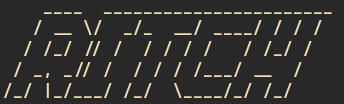

# ritch



A fast and minimalist terminal utility written in Rust.

## Installation

### Nix / NixOS (Recommended)
Run directly via Nix Flakes without manual installation:
```bash
nix run github:davidykmisha2015-prog/ritch
